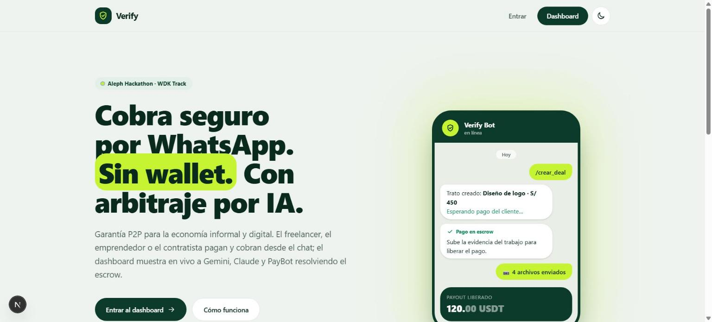

# Verify

**Cobra y paga seguro por WhatsApp. Sin wallet, con arbitraje por IA.**
*Get paid and pay safely over WhatsApp. No crypto wallet needed, AI-judged disputes.*

Verify holds a client's money safely until the work is done, then releases it to the worker automatically. Two AIs look at the proof of work and decide, so nobody has to argue or trust a stranger.

It is built for people who work and sell on their own: **freelancers, entrepreneurs who sell through Instagram and WhatsApp, and independent contractors.**

> Hackathon project · Aleph Hackathon, WDK track.

---

## Why it exists

When you work with someone you don't know, both sides worry:

- **The client** is afraid to pay first and get nothing.
- **The worker** is afraid to deliver first and not get paid.
- **If there is a dispute,** there is no neutral judge and no proof, so it turns into an argument.

## How it works

Think of a freelance designer and a new client:

1. **The designer opens a deal** by messaging the Verify bot on WhatsApp: `/crear_deal`. The bot gives a link to share with the client.
2. **The client pays.** The money does not go to the designer yet. Verify holds it safely.
3. **The designer sends proof** of the finished work (for example, photos or screenshots).
4. **Two AIs review the proof** and vote. You can watch them vote live on the web dashboard.
5. **If they agree the work was done,** the payment is released automatically in USDT, a digital dollar.

Nobody needs to know anything about crypto. It all happens in a chat.

---

## See it

**Landing page**



**Dashboard** (sample data)


**The chat, step by step**: create a deal, pay, send proof, and get paid (sample session)

<p align="center"></p>

---

## Try it yourself

| What | Link |
|---|---|
| **Chat with the bot** (looks like WhatsApp, nothing to install) | https://verify-bot-21i6.onrender.com/demo |
| **Dashboard** | https://frontend-gilt-pi-76.vercel.app |
| Server behind the scenes (API) | Being set up on Render, link coming soon |

How to test the chat:
1. Open the chat link and tap **/crear_deal**.
2. Type a service ("Logo design") and a price ("450").
3. Tap **/pagar**, then **Enviar foto**, then **/arbitrar**.
4. The bot tells you the payment was released.

> **Heads up:** these free servers fall asleep when nobody uses them. The first time you open a link it can take up to a minute to wake up.

---

## What is real and what is a demo

| Part | Status |
|---|---|
| WhatsApp-style bot, web dashboard, live view of the AI vote | Working |
| **The USDT payment** (a real transaction on a test network, you can check it on Etherscan) | **Real** |
| Local payment methods (QR, bank transfer) | Simulated |
| The two AIs (Gemini and Claude) judging the proof | Simulated |
| Saving the photos | Simulated |
| Saving deals | Temporary: deals disappear when the server restarts |

---

## What's inside

| Folder | What it is |
|---|---|
| [`bot/`](bot/README.md) | The chat bot and the test chat page |
| [`backend/`](backend/README.md) | The server that holds deals, payments and the AI vote |
| [`frontend/`](frontend/README.md) | The website and dashboard |
| [`contracts/`](contracts/README.md) | The test "digital dollar" used for payments |

The original long technical document (in Spanish) is in [`docs/DETAILED_SPEC.md`](docs/DETAILED_SPEC.md).

---

## For developers

<details>
<summary><b>Run it on your computer</b></summary>

You need **Node 22+** and **Python 3.11+**. Open three terminals.

**1. Server** (port 8000)
```bash
cd backend
pip install -r requirements.txt
cp .env.example .env        # set JWT_SECRET to any text, CORS_ORIGINS=http://localhost:3000
uvicorn main:app --port 8000
```

**2. Bot** (port 3001)
```bash
cd bot
npm install
cp .env.example .env        # set BACKEND_URL=http://localhost:8000
npm start
```
Open the test chat at http://localhost:3001/demo

**3. Dashboard** (port 3000)
```bash
cd frontend
npm install
echo "NEXT_PUBLIC_API_URL=http://localhost:8000" > .env.local
npm run dev
```
Open http://localhost:3000 and log in with the same phone number you used in the chat (for example `+51999999999`).

Run the tests with `cd backend && pytest`.
</details>

<details>
<summary><b>Check a real payment on the test network</b></summary>

Payments use a dedicated test wallet with no real value, through Tether's `@tetherto/wdk-cli` on the Sepolia test network.

```bash
# 1. Install the CLI (Node >= 22.18.0), then open a NEW terminal
npm install -g @tetherto/wdk-cli

# 2. Import and unlock the test wallet
export WDK_PASSPHRASE="verify-demo-2026"
echo "ketchup mistake verify observe face chunk lunar palace retire february begin lecture" | wdk wallet import --name verify --seed-stdin
wdk wallet unlock --name verify --ttl 0

# 3. Register the test token
wdk token add '{"network":"sepolia","token":"musdt","symbol":"USDT","decimals":6,"isNative":false,"address":"0x859e861cfA14f8e5aA5765Fe3941670FB41E5A8A"}'

# 4. Send a payment
wdk send --network sepolia --to 0x000000000000000000000000000000000000dEaD --amount 1 --token musdt --wallet verify --json
```

The command returns a transaction hash. Open `https://sepolia.etherscan.io/tx/<hash>` to confirm it.

Payments already made during development:
[`0x65cb292a…988613`](https://sepolia.etherscan.io/tx/0x65cb292a20b26e2df039a749b8b16ee4d79cde37b526a7fe84e63932c9988613) ·
[`0xb3b540a6…1ac160`](https://sepolia.etherscan.io/tx/0xb3b540a6913d1fe909527b9a46ffb37ffe3ee23cb3739ea458b15da1da1ac160)
</details>

<details>
<summary><b>Put it online (Render)</b></summary>

The repo includes a [`render.yaml`](render.yaml) that creates the server and the bot on Render's free plan.

1. On render.com, choose **New → Blueprint** and pick this repo.
2. Fill in the secret values it asks for (`WDK_PASSPHRASE`, `WDK_SEED`, and the bot's `BACKEND_URL`).
3. Copy the server's web address into the bot's `BACKEND_URL` and into `NEXT_PUBLIC_API_URL` on Vercel.
</details>

<details>
<summary><b>How the pieces connect</b></summary>

```
WhatsApp / web chat  →  Bot (Node.js)  →  Server (FastAPI)  →  WDK → Sepolia
                                               │
                                               └──→  live updates  →  Dashboard (Next.js)
```
</details>

---

## Resumen en español

Verify es una garantía para quienes trabajan por su cuenta: freelancers, emprendedores que venden por redes y contratistas independientes. El cliente paga, el dinero queda protegido hasta que el trabajo esté hecho, dos IAs revisan las pruebas y el pago se libera solo en USDT. Todo desde un chat de WhatsApp, sin que nadie necesite una wallet. El pago en USDT es real (en una red de pruebas); los métodos de pago locales, las IAs y las fotos están simulados. Para probarlo, usa el link del chat en la sección **Try it yourself**.

## License

See [LICENSE](LICENSE).
