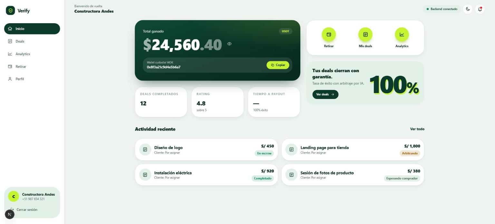
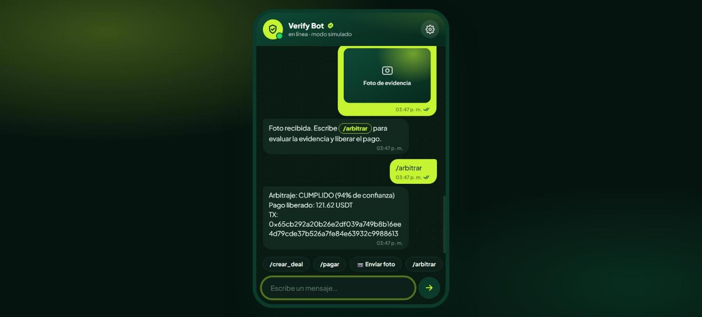

# Verify

**Cobra y paga seguro por WhatsApp. Sin wallet, con arbitraje por IA.**
*Safe P2P payments over WhatsApp. No wallet needed, AI-arbitrated.*

Verify is an escrow ("guarantee") service for the informal and digital economy: freelancers, entrepreneurs who sell through Instagram and WhatsApp, and independent contractors and technicians. The client pays, the money is held until the work is done, two AIs review the evidence, and the payout is released automatically in USDT. Everything starts from a WhatsApp chat.

> Hackathon project · Aleph Hackathon, WDK track.

---

## The problem

In the informal and digital economy, nobody fully trusts the other side.

- **The client** is afraid to pay before the job is done.
- **The worker** is afraid to do the job and not get paid.
- **Disputes** end in arguments, because there is no neutral judge and no proof.

## How Verify solves it

1. **Create a deal.** The worker writes `/crear_deal` to the WhatsApp bot and shares the link with the client.
2. **Pay into escrow.** The client pays with a local method (QR or bank transfer). The funds stay locked.
3. **Upload evidence.** The worker sends photos of the finished job.
4. **AI arbitration.** Gemini and Claude vote on the evidence. Both votes and the final verdict are visible live in the dashboard.
5. **Automatic payout.** If they agree, the payout is released in USDT through Tether's WDK. If not, the case is marked as a dispute.

The user never sees a blockchain or needs a crypto wallet.

---

## Screenshots

**Landing page**


**Dashboard** (sample data)



**WhatsApp-style test chat**: create a deal, pay into escrow, upload evidence and run the AI arbitration, ending with the USDT payout (sample session)

<p align="center"></p>

---

## Try it

| What | Where |
|---|---|
| Dashboard | https://frontend-gilt-pi-76.vercel.app |
| Bot test chat | `/demo` on the bot server (see "Run it locally") |
| API docs (Swagger) | `/docs` on the backend server |

> **Note:** the backend and the bot were hosted on a free Railway trial that has ended, so they are being moved to [Render](https://render.com) (see [Deploy on Render](#deploy-on-render)). Until the links are updated here, run the project locally. It takes about five minutes.

The bot runs in **simulated mode** (no real WhatsApp Business account needed). The `/demo` page is a web chat that looks like WhatsApp and talks to the real bot, so you can test the whole flow without installing anything on your phone.

---

## What is real and what is simulated

| Piece | Status |
|---|---|
| WhatsApp bot, backend API, dashboard, live arbitration view | Real, working code |
| **Payouts with `@tetherto/wdk-cli` on Sepolia testnet** | **Real transactions**, verifiable on Etherscan |
| Kapso payments (QR / bank transfer) | Simulated |
| AI arbitration (Gemini + Claude) | Simulated |
| Photo storage (IPFS) | Simulated |
| Database | In memory (data resets when the server restarts) |

---

## Verify a real payment

The payout uses a dedicated test wallet with no real value. It holds a custom test token (`musdt`, same ERC-20 standard as USDT, 6 decimals; see [`contracts/`](contracts/README.md)) and Sepolia ETH for gas.

```bash
# 1. Install the CLI (Node >= 22.18.0). Then open a NEW terminal.
npm install -g @tetherto/wdk-cli

# 2. Import and unlock the test wallet
export WDK_PASSPHRASE="verify-demo-2026"
echo "ketchup mistake verify observe face chunk lunar palace retire february begin lecture" | wdk wallet import --name verify --seed-stdin
wdk wallet unlock --name verify --ttl 0

# 3. Register the test token (deployed at the address in contracts/deployed.json)
wdk token add '{"network":"sepolia","token":"musdt","symbol":"USDT","decimals":6,"isNative":false,"address":"0x859e861cfA14f8e5aA5765Fe3941670FB41E5A8A"}'

# 4. Send a real transfer
wdk send --network sepolia --to 0x000000000000000000000000000000000000dEaD --amount 1 --token musdt --wallet verify --json
```

The command returns a `txHash`. Open `https://sepolia.etherscan.io/tx/<hash>` to confirm it.

Transactions already mined during development:
[`0x65cb292a…988613`](https://sepolia.etherscan.io/tx/0x65cb292a20b26e2df039a749b8b16ee4d79cde37b526a7fe84e63932c9988613) ·
[`0xb3b540a6…1ac160`](https://sepolia.etherscan.io/tx/0xb3b540a6913d1fe909527b9a46ffb37ffe3ee23cb3739ea458b15da1da1ac160)

---

## Run it locally

You need **Node 22+** and **Python 3.11+**. Open three terminals.

**1. Backend** (port 8000)
```bash
cd backend
pip install -r requirements.txt
cp .env.example .env        # set JWT_SECRET to any text, CORS_ORIGINS=http://localhost:3000
uvicorn main:app --port 8000
```
Check it: http://localhost:8000/health

**2. Bot** (port 3001)
```bash
cd bot
npm install
cp .env.example .env        # set BACKEND_URL=http://localhost:8000
npm start
```
Open the test chat: http://localhost:3001/demo

**3. Dashboard** (port 3000)
```bash
cd frontend
npm install
echo "NEXT_PUBLIC_API_URL=http://localhost:8000" > .env.local
npm run dev
```
Open http://localhost:3000 and log in with the same phone number you use in the chat (for example `+51999999999`).

**Real WDK payouts (optional).** Add `WDK_WALLET_NAME=verify`, `WDK_PASSPHRASE=verify-demo-2026`, `WDK_NETWORK=sepolia` and `WDK_TOKEN=musdt` to `backend/.env`, and follow [`backend/README.md`](backend/README.md).

---

## Deploy on Render

The repo includes a [`render.yaml`](render.yaml) blueprint that creates the backend and the bot on Render's free plan.

1. On render.com, go to **New → Blueprint** and pick this repo.
2. Render asks for the values marked as secret: `WDK_PASSPHRASE` and `WDK_SEED` (backend) and `BACKEND_URL` (bot).
3. After the first deploy, copy the backend URL into the bot's `BACKEND_URL`, and into `NEXT_PUBLIC_API_URL` in Vercel.

Free services sleep after 15 minutes without traffic, so the first request can take about a minute.

---

## Walkthrough

In the test chat at `/demo`, tap the buttons in this order:

1. `/crear_deal`, then answer with a service ("Reparar cañería") and an amount ("150"). The bot returns a link to the deal.
2. `/pagar` to simulate the client's payment.
3. **Enviar foto** to upload evidence.
4. `/arbitrar` to run the AI arbitration and release the payout.
5. Open the deal link, or `/dashboard/deals/<id>/live`, to watch the two AIs vote in real time.

Prefer a terminal? The bot also accepts plain HTTP:
```bash
curl -X POST http://localhost:3001/dev/simulate-message \
  -H "Content-Type: application/json" \
  -d '{"from":"+51999999999","text":"/crear_deal"}'
```

---

## How it is built

```
WhatsApp / web chat  →  Bot (Node.js)  →  Backend (FastAPI)  →  WDK CLI → Sepolia
                                               │
                                               └──→  WebSocket  →  Dashboard (Next.js)
```

| Folder | What it does | Tech |
|---|---|---|
| [`bot/`](bot/README.md) | Conversation with the user, commands, test chat page | Node.js, Express |
| [`backend/`](backend/README.md) | Deals, payments, arbitration, payouts, live updates | Python, FastAPI |
| [`frontend/`](frontend/README.md) | Dashboard: deals, analytics, withdrawals, live arbitration | Next.js, React, Tailwind |
| [`contracts/`](contracts/README.md) | Test token (`musdt`) used for the payouts | Solidity |

Run the tests with `cd backend && pytest`. CI runs them on every push.

---

## More documentation

The original technical spec and hackathon plan (in Spanish) is kept in [`docs/DETAILED_SPEC.md`](docs/DETAILED_SPEC.md). It includes the full transaction flows (milestone payments, Airbnb-style deposits), the data model and the API endpoint list.

---

## Resumen en español

Verify es una garantía (escrow) para freelancers, emprendedores que venden por redes y contratistas independientes. El cliente paga, el dinero queda retenido hasta que el trabajo esté hecho, dos IAs (Gemini y Claude) revisan las fotos de evidencia y el pago se libera automáticamente en USDT. Todo empieza con un chat de WhatsApp, sin que el usuario necesite una wallet. Los pagos con WDK en Sepolia son reales; Kapso, el arbitraje por IA y el almacenamiento de fotos están simulados. Para probarlo, sigue la sección **Run it locally**.

## License

See [LICENSE](LICENSE).
